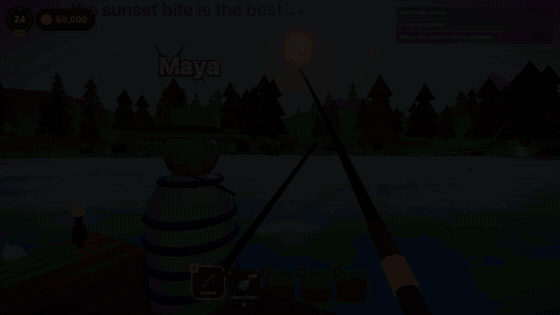
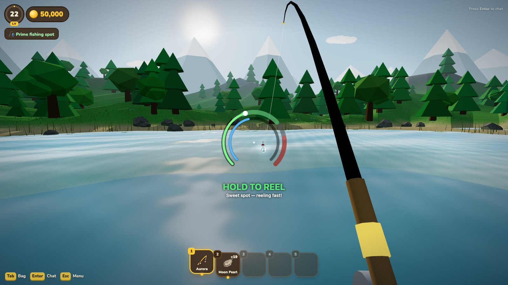
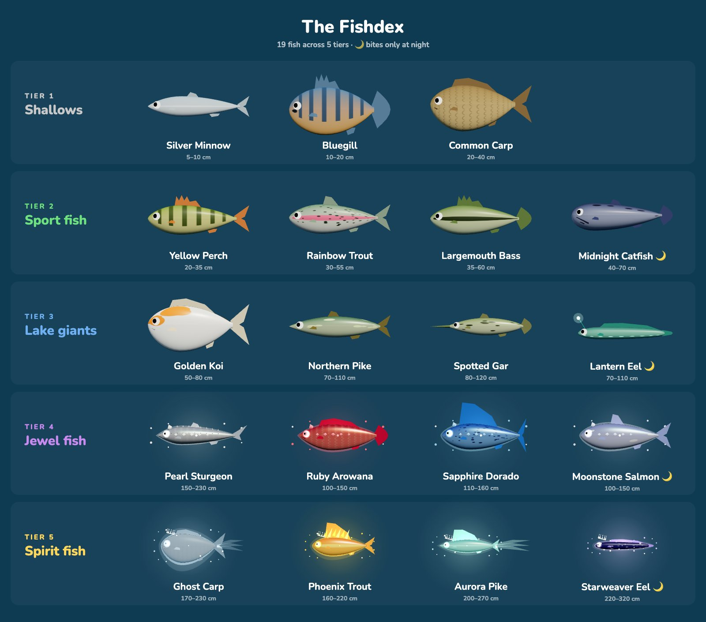
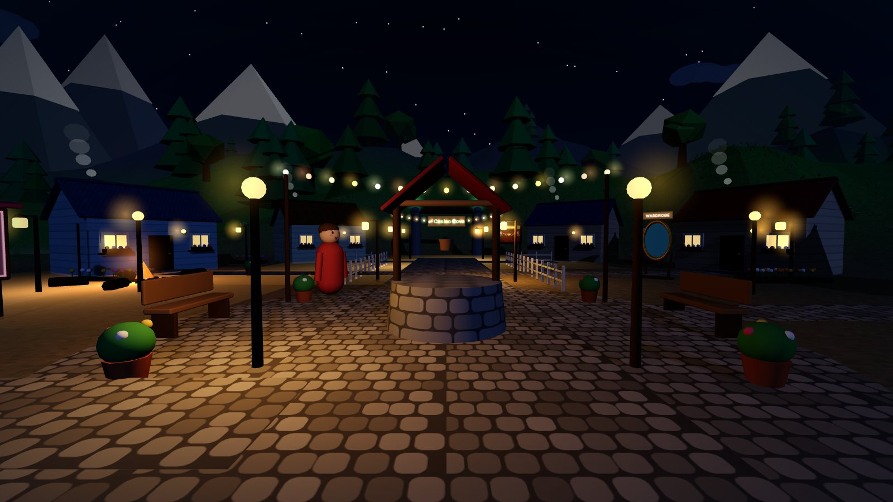
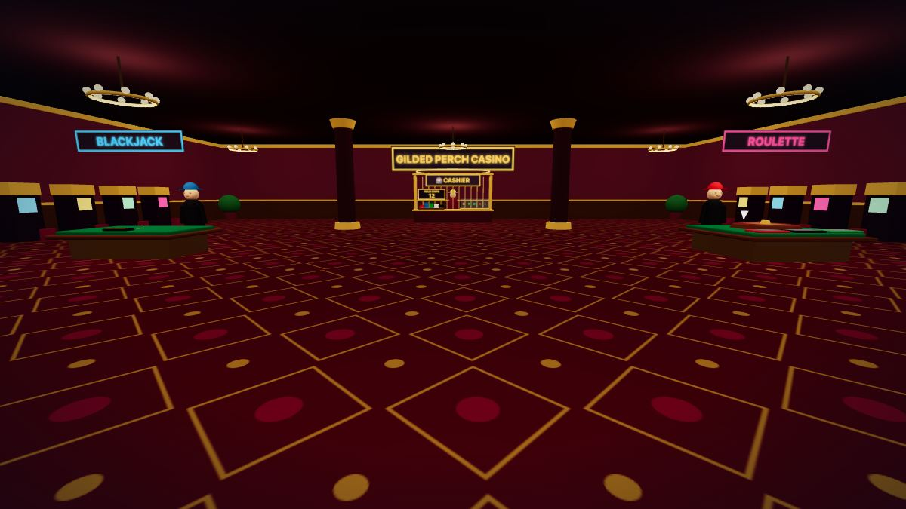
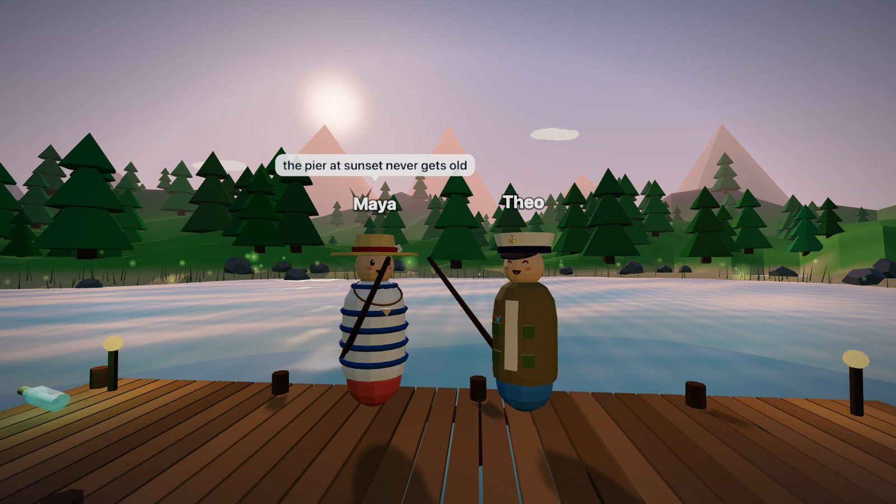
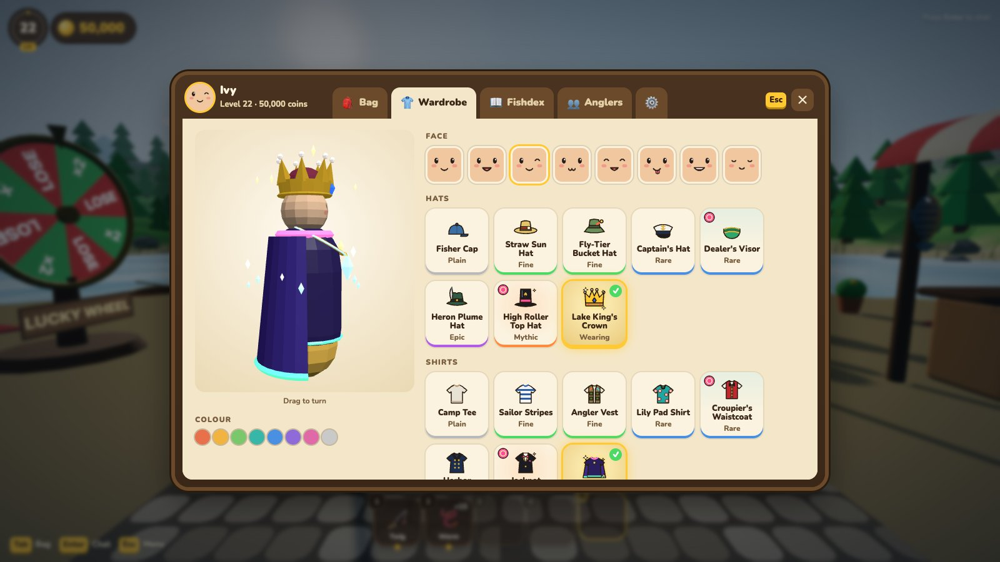

# Browser Fishing

### Fish with friends online for free!

**[▶ Play now in your browser](https://browser-fishing-1.onrender.com/)**: no download, no sign-up, just pick a name and cast.



[Watch in HD (MP4)](docs/images/gameplay.mp4)

Grab a rod and head down to the pier. In this cozy multiplayer fishing game, everyone shares one lakeside town. You can hang out with your friends, cast side by side as the sun goes down, and trade stories about the one that got away. Start with a twig rod and a can of worms, and work your way up to hunting mythic Spirit Fish under the stars. When you're feeling lucky, bet your best catch at the casino.

## About this game

**🎣 Every catch is a fight.** Charge your cast, nail the gold zone for a perfect throw, and hook the fish the moment the bobber dips. Then the battle starts: reel it in, ease off when it surges, and keep your line from snapping. Big fish fight hard.



**🐟 20 species to discover.** You'll start with Silver Minnows and Bluegill in the Shallows. Then come the Sport Fish and the Lake Giants, then the gem-bright Jewel Fish. At the top are the legendary Spirit Fish: the Ghost Carp, the Phoenix Trout and the Starweaver Eel. Each one has its own look, and the rarest are huge. Fill your **Fishdex** and chase your personal records.



**🌙 The lake changes after dark.** A full day/night cycle brings out fish you'll never see at noon. Night is also the best time to hook a **shiny**: a rare golden variant worth five times as much.



**📈 Level up from Worm to Moon Pearl.** Sell your catch, buy better bait and rods, and reach new tiers of fish. There are 50 levels to climb, and none of it is pay-to-win: everything is earned on the water.

**🎰 Welcome to Casino Cove.** Reach level 15 and the gate to the casino opens. Put a fish on the line at **roulette** or **blackjack** and push its value as high as 16×, or lose it all. Trade your winnings for chips and spend them on perks like Lucky Charms, Quick-Reel Gloves and Shiny Lures.



**👋 Fish together.** See other players walking the docks and reeling in catches in real time. Chat with the whole server, watch speech bubbles pop up over players' heads, and race for a spot on the **Top Anglers** leaderboard.



**🎩 Make it yours.** Choose a face and a colour, and dress up in 25 hats, shirts and pieces of jewellery from the town stall and the casino prize counter.



**🗺️ A town worth exploring.** Chat with Old Salty, Granny Wren and the other locals, try your luck on the lucky wheel, and track down the seven messages in bottles hidden around the map.

### Features at a glance
- Free to play, right in your browser, on any desktop (early touch controls for phones and tablets)
- Online multiplayer with global chat
- 20 fish species across 5 tiers, plus rare shiny variants
- 5 rods, 5 baits and 50 levels of progression
- Day/night cycle with night-only fish
- Casino Cove with roulette, blackjack and a perk shop
- Fishdex, records and a live leaderboard
- Character customisation: faces, colours, hats, shirts and jewellery
- Your progress is saved on the server, so just log back in with your name

## Controls

| Key | Action |
|---|---|
| W A S D / Shift / Space | Walk / run / jump |
| Hold click → release | Charge and cast |
| Click | Hook a bite |
| Hold click | Reel (let go when the fish surges) |
| E | Talk / interact |
| 1-5 / scroll | Pick a hotbar item |
| G | Drop the item in your hand |
| Tab | Bag and player list |
| Enter | Chat |
| M | Music on/off |
| Esc | Menu / close |

**On a phone or tablet (early test):** tap "Try touch controls" on the desktop notice and play in landscape. Push the left thumbstick to walk (past the rim to run), drag anywhere else to look, and hold the big button to cast and reel. Tap the prompt to talk, a hotbar slot to switch, and the casino tables to bet.

## Tech stack

| Area | Technology |
|---|---|
| Language | TypeScript, used on both client and server |
| Rendering | [Three.js](https://threejs.org/) (WebGL). All models are built in code from primitives, with no 3D asset files |
| Client build | [Vite](https://vite.dev/) |
| Server | Node.js with [`ws`](https://github.com/websockets/ws) WebSockets, run with `tsx` |
| Persistence | PostgreSQL (`pg`) in production, JSON files locally |
| Audio | Web Audio API: music and sound effects are synthesised at runtime |
| Testing | [Vitest](https://vitest.dev/) unit tests, plus a headless-Chrome smoke test (Puppeteer) and a render benchmark |
| Hosting | [Render](https://render.com/), as a single web service that serves both the built client and the WebSocket server |

## Architecture

```
 Browser (Three.js client)                    Node server
┌──────────────────────────┐   WebSocket    ┌──────────────────────────┐
│ src/game   rendering,    │ ◄────────────► │ server/index.ts  HTTP +  │
│            input, UI     │  JSON messages │   static files + WS      │
│ src/data   fish, gear,   │  (protocol.ts) │ server/room.ts  one room │
│            maps, casino  │                │   per map: rolls casts,  │
└──────────────────────────┘                │   shop, casino, chat     │
            ▲                               │ server/accounts.ts       │
            └── shared TypeScript ─────────►│ server/storage.ts ─► Postgres / JSON
                (src/data, src/game rules)  └──────────────────────────┘
```

- **Client** (`src/`): the Three.js scene, player controller, reel minigame, HUD and menus. Game content (fish, rods, baits, maps, cosmetics, casino tuning) is plain TypeScript data in `src/data/`.
- **Server** (`server/`): owns every save. When you cast, the server rolls what bites, and catches, sales, purchases and casino bets are all checked server-side, so the client can't award itself coins or fish.
- **Shared code**: the server imports the same rule modules as the client (`src/game/economy.ts`, `progression.ts`, `casino.ts`), so both sides always agree on prices, odds and level gates. Message types live in `src/net/protocol.ts`.
- **Saves**: accounts are stored through a small storage interface that uses PostgreSQL when `DATABASE_URL` is set and JSON files otherwise. Older saves are migrated on load.

## Running locally

Requires Node.js 20+.

```bash
npm install
npm run dev:all     # game server on :8787 + Vite dev server
```

Then open the URL Vite prints (usually http://localhost:5173).

| Command | What it does |
|---|---|
| `npm run dev:all` | Game server and Vite client together |
| `npm run build` | Type-check and build the client into `dist/` |
| `npm start` | Run the server, which also serves `dist/` (production mode) |
| `npm test` | Unit tests (Vitest) |
| `npm run smoke` | End-to-end smoke test in headless Chrome |
| `npm run bench` | Render benchmark |
| `npm run screenshots` | Regenerate the README screenshots in `docs/images/` |
| `npm run trailer` | Re-record the README gameplay clip (`docs/images/gameplay.mp4` and `.gif`); needs ffmpeg |

Environment variables (all optional locally): `PORT`, `DATABASE_URL` (use Postgres instead of JSON files), `DATA_DIR` (where the JSON saves go).
