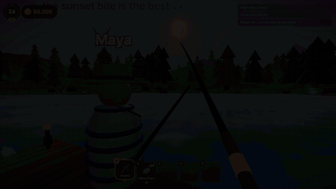
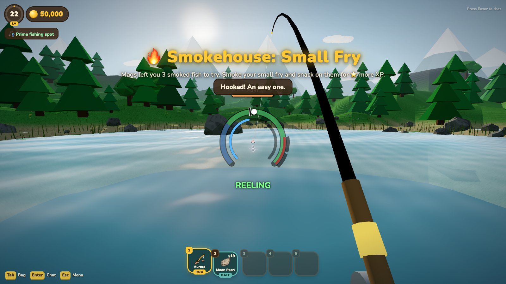
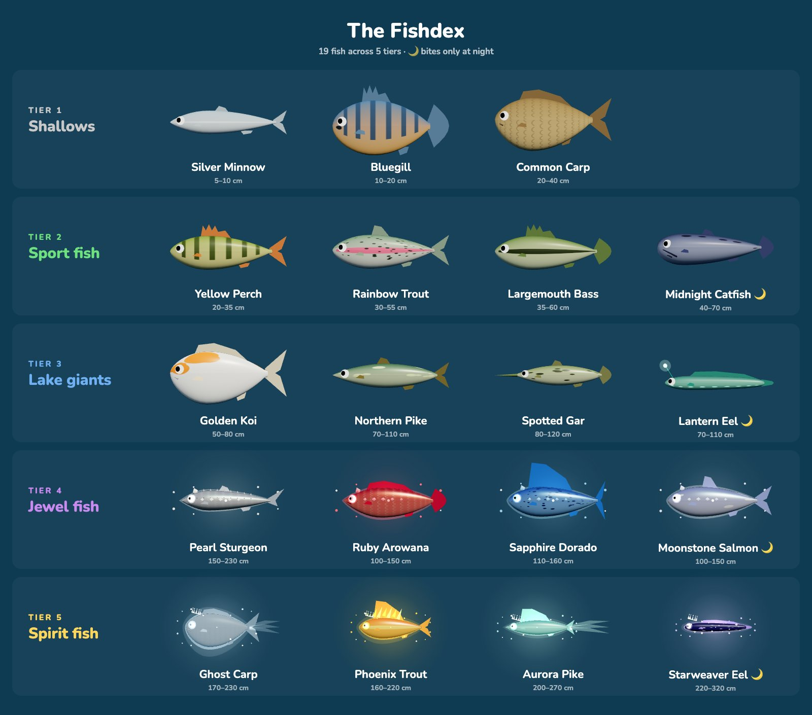
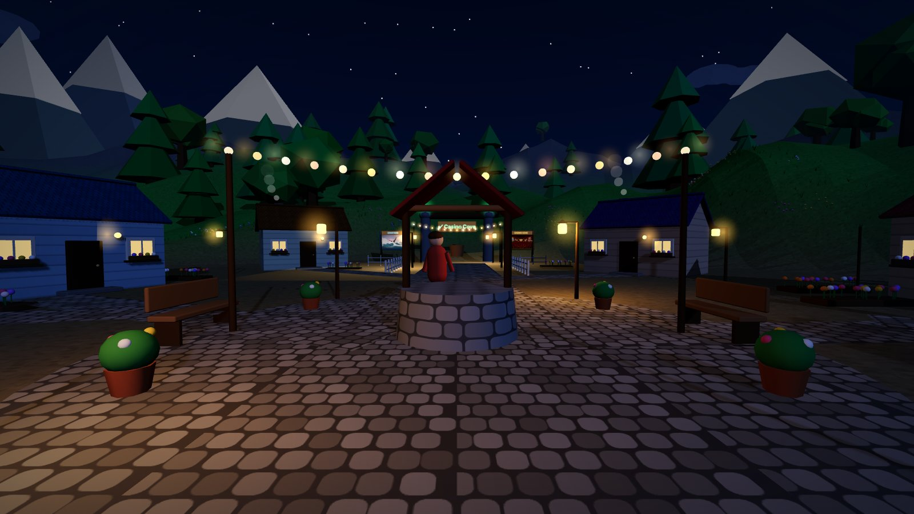
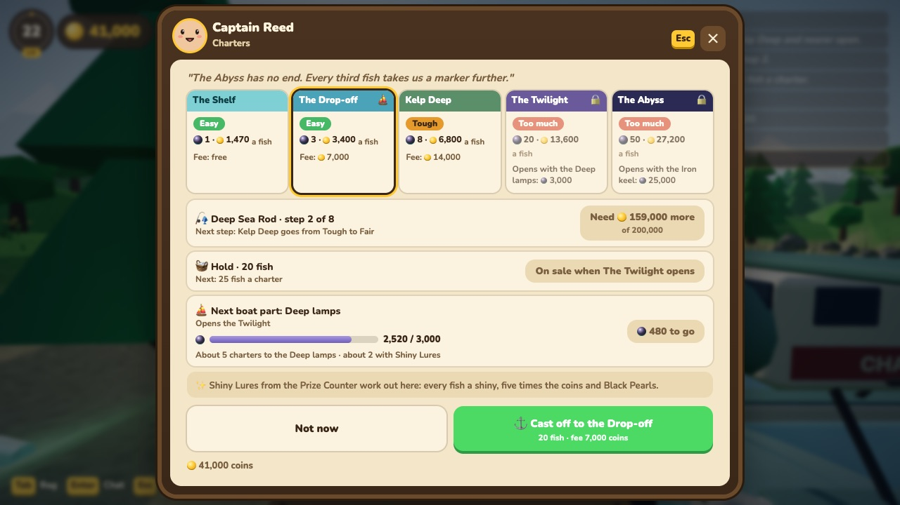
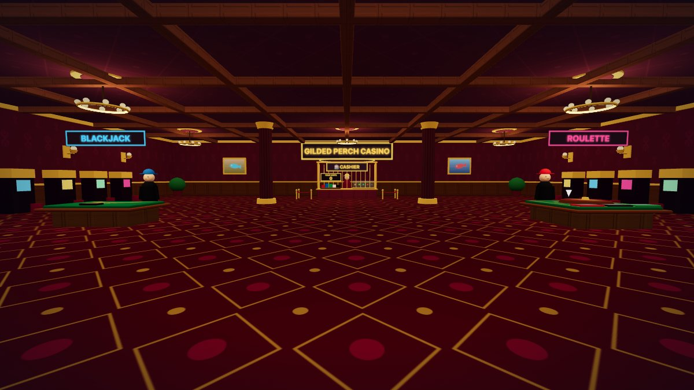
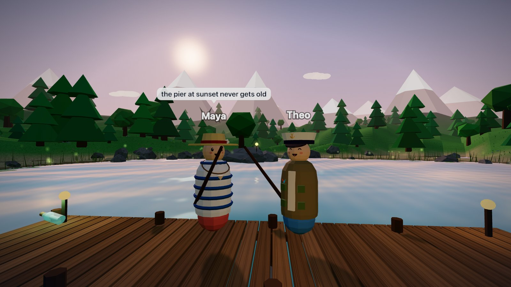
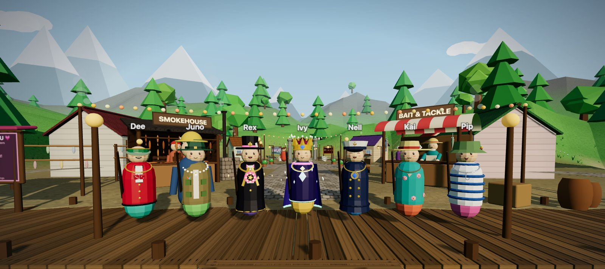
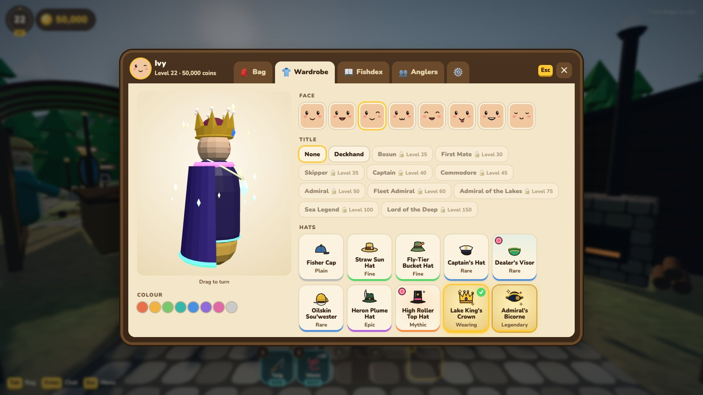
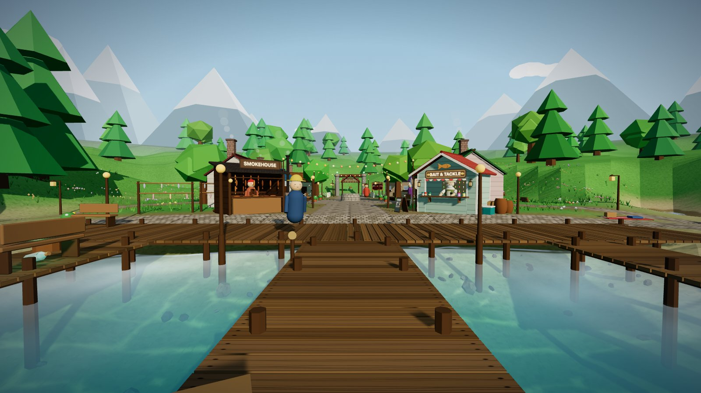

# Browser Fishing

### Fish with friends online for free!

**[▶ Play now in your browser](https://browser-fishing-1.onrender.com/)**: no download: pick a name and a password, and cast.



[Watch in HD (MP4)](docs/images/gameplay.mp4)

Grab a rod and head down to the pier. In this cozy multiplayer fishing game, everyone shares one lakeside town. You can hang out with your friends, cast side by side as the sun goes down, and trade stories about the one that got away. Start with a twig rod and a can of worms, and work your way up to hunting mythic Spirit Fish under the stars, then charter a boat out to the open sea. When you're feeling lucky, bet your best catch at the casino.

## About this game

**🎣 Every catch is a fight.** Charge your cast, nail the gold zone for a perfect throw, and hook the fish the moment the bobber dips. Then the battle starts: reel it in, ease off when it surges, and keep your line from snapping. Big fish fight hard.



**🐟 19 lake fish to discover.** You'll start with Silver Minnows and Bluegill in the Shallows. Then come the Sport Fish and the Lake Giants, then the gem-bright Jewel Fish. At the top are the legendary Spirit Fish: the Ghost Carp, the Phoenix Trout and the Starweaver Eel. Each one has its own look, and the rarest are huge. Fill your **Fishdex** and chase your personal records. The sea has 23 more fish, on a Fishdex page of their own.



**🌙 The lake changes after dark.** A full day/night cycle brings out fish you'll never see at noon. Night is also the best time to hook a **shiny**: a rare golden variant worth five times as much.



**📈 Level up from Worm to Moon Pearl.** Sell your catch, buy better bait, line and rods, and reach new tiers of fish. Levels have no cap: from level 20 you earn nautical ranks, from Deckhand to Admiral at 50 and on to Lord of the Deep at 150, which puts an anchor by your name. None of it is pay-to-win: everything is earned on the water.

**⚓ Charter out to the deep sea.** At level 20, **Captain Reed** on the west beach sells the **Deep Sea Rod** and takes you out on a charter. Pick one of five zones, from **the Shelf** to **the Abyss**, and cast off. Each charter fills Reed's **hold** for a small fee: 10 fish to start, up to 30 as you buy bigger holds, and a fish that gets away takes no room. Fish pay coins and **Black Pearls**, and each zone out pays about twice the coins of the one before. Coins buy the hold and the rod's eight steps, and pearls fill the bar for four **boat parts** that open the zones one by one. Only the Abyss has **markers**: every five fish you land takes you one further out, where the fish fight harder and pay more. The rarest sea fish are legends, up to **the Kraken**, and the **Furthest Out** board by Reed's lane shows how far each angler's boat reaches. In his **Wardrobe** tab Reed makes up sets from the deep (one each for Kelp Deep and the Twilight, and one for each Abyss legend, with a pet) and, once you own a zone's sets, sells its deep sea emote for coins and Black Pearls.



**🎰 Welcome to Casino Cove.** Reach level 15 and the gate to the casino opens. Put a fish on the line at **roulette** or **blackjack** and push its value as high as 16×, or lose it all. Spin the **Lucky Wheel** with a fish and it comes back worth ×5, ×2 or half as much, or it's gone. Trade your winnings for chips and spend them on perks like Lucky Charms, Quick-Reel Gloves and Shiny Lures.



**🔥 Smoke your catch.** From level 3, Mags Cinder's Smokehouse across the path from Marlow's stall smokes your spare fish in seconds (and keeps smoking while you're offline). Sell small fry smoked for more, eat one as a snack for ⭐ more XP or 💰 more coins on every catch, or cook smoked fish into dishes that give several buffs at once, up to ✨ more shinies.

**👋 Fish together.** See other players walking the docks and reeling in catches in real time. Chat with the whole server, watch speech bubbles pop up over players' heads, wave, clap or nod from the emote wheel, sit down together round the fire at Anglers' Rest, and race for a spot on the **Lake Legends** and **Deep Sea** boards, where the record catch hangs over each.



**🎩 Make it yours.** Choose a face and a colour, and dress up in 24 hats, shirts and pieces of jewellery from the town stall and the casino prize counter.





**🗺️ A town worth exploring.** Chat with Old Salty, Granny Wren and the other locals and track down the seven messages in bottles hidden around the map. The town wraps a small harbour cove, with the pier at its middle, Marlow's stall and the Smokehouse on the quay, and Captain Reed's seaplane tied up at his wharf on the west beach.



### Features at a glance
- Free to play, right in your browser, on a computer, phone or tablet
- Online multiplayer with global chat
- 19 lake fish across 5 tiers and 23 sea fish across 5 zones, plus rare shiny variants
- 5 rods, 5 lines and 5 baits, plus the Deep Sea Rod, and levels with no cap
- Deep sea charters: five zones, a hold that grows, a rod with eight steps, boat parts and endless Abyss markers
- Day/night cycle with night-only fish
- Casino Cove with roulette, blackjack, the Lucky Wheel and a perk shop
- A Smokehouse that turns spare fish into snacks and dishes that buff your catches
- Fishdex, records, a live leaderboard and a Furthest Out board for charters
- Character customisation: faces, colours, hats, shirts and jewellery, plus deep sea sets and pets
- Emotes: a wheel of eight, four for everyone and four earned at sea
- Your progress is saved on the server, so just log back in with your name

## Support

Lakeside is free with no ads, made by one person. If you enjoy it, you can leave a tip on Ko-fi. Tips never give anything in game. Write your Lakeside name in the Ko-fi message and a 💗 appears by your name, plus a thank-you on the supporters board in town.

[](https://ko-fi.com/ochavez)

## Controls

| Key | Action |
|---|---|
| W A S D / Shift / Space | Walk / run / jump |
| Hold click → release | Charge and cast |
| Click | Hook a bite |
| Hold click | Reel (let go when the fish surges) |
| E | Talk / interact |
| Hold F | Emote wheel: move the mouse to an emote, let go to play it |
| 1-5 / scroll | Pick a hotbar item (1 rod, 2 bait, 3+ fish) |
| G | Drop the item in your hand |
| Tab | Bag and player list |
| Enter | Chat |
| M | Music on/off |
| Esc | Menu / close |

**On a phone or tablet:** play in landscape. Push the left thumbstick to walk (past the rim to run), drag anywhere else to look, and hold the big button to cast and reel. Tap the prompt to talk, a hotbar slot to switch (hold one to drop it), and the casino tables to bet. 🎒 opens your bag and 💬 opens chat with its own keyboard. Hold 👋 and drag to an emote to play it, or tap 👋 and tap one.

## Tech stack

| Area | Technology |
|---|---|
| Language | TypeScript, used on both client and server |
| Rendering | [Three.js](https://threejs.org/) (WebGL). All models are built in code from primitives, with no 3D asset files |
| Client build | [Vite](https://vite.dev/) |
| Server | Node.js with [`ws`](https://github.com/websockets/ws) WebSockets, run with `tsx` |
| Persistence | PostgreSQL (`pg`) in production, JSON files locally |
| Audio | Web Audio API: music and sound effects are synthesised at runtime |
| Testing | [Vitest](https://vitest.dev/) unit tests, plus a headless-Chrome smoke test (Puppeteer) and a render benchmark |
| Hosting | [Render](https://render.com/), as a single web service that serves both the built client and the WebSocket server |

## Architecture

```
 Browser (Three.js client)                    Node server
┌──────────────────────────┐   WebSocket    ┌──────────────────────────┐
│ src/game   rendering,    │ ◄────────────► │ server/index.ts  HTTP +  │
│            input, UI     │  JSON messages │   static files + WS      │
│ src/data   fish, gear,   │  (protocol.ts) │ server/room.ts  one room │
│            maps, casino  │                │   per map: rolls casts,  │
└──────────────────────────┘                │   shop, casino, chat     │
            ▲                               │ server/accounts.ts       │
            └── shared TypeScript ─────────►│ server/storage.ts ─► Postgres / JSON
                (src/data, src/game rules)  └──────────────────────────┘
```

- **Client** (`src/`): the Three.js scene, player controller, reel minigame, HUD and menus. Game content (fish, rods, baits, maps, cosmetics, casino tuning) is plain TypeScript data in `src/data/`.
- **Server** (`server/`): owns every save. When you cast, the server rolls what bites, and catches, sales, purchases and casino bets are all checked server-side, so the client can't award itself coins or fish.
- **Shared code**: the server imports the same rule modules as the client (`src/game/economy.ts`, `progression.ts`, `casino.ts`, `smoke.ts`, `dive.ts`), so both sides always agree on prices, odds and level gates. Message types live in `src/net/protocol.ts`.
- **Saves**: accounts are stored through a small storage interface that uses PostgreSQL when `DATABASE_URL` is set and JSON files otherwise. Older saves are migrated on load.

## Running locally

Requires Node.js 20+.

```bash
npm install
npm run dev:all     # game server on :8787 + Vite dev server
```

Then open the URL Vite prints (usually http://localhost:5173).

| Command | What it does |
|---|---|
| `npm run dev:all` | Game server and Vite client together |
| `npm run build` | Type-check and build the client into `dist/` |
| `npm start` | Run the server, which also serves `dist/` (production mode) |
| `npm test` | Unit tests (Vitest) |
| `npm run smoke` | End-to-end smoke test in headless Chrome |
| `npm run bench` | Render benchmark (`npm run bench:compare` compares runs, `npm run bench:ab -- <before> <after>` times two commits) |
| `npm run bench:load` | Load-hitch probe: frame gaps and shader compiles from page load through joining |
| `npm run screenshots` | Regenerate the README screenshots in `docs/images/` |
| `npm run trailer` | Re-record the README gameplay clip (`docs/images/gameplay.mp4` and `.gif`); needs ffmpeg |

Environment variables (all optional locally): `PORT`, `DATABASE_URL` (use Postgres instead of JSON files), `DATA_DIR` (where the JSON saves go), `DEV_USER`/`DEV_PASS` (dev console login), `DISCORD_JOINS_WEBHOOK` (batched "player joined" pings), `DISCORD_FEEDBACK_WEBHOOK` (one forum post per `/bug`, `/idea` or `/feedback` report; reports are kept in storage when it is unset or Discord is down) `DISCORD_FEEDBACK_TAGS` (optional forum tag ids, e.g. `bug=123,idea=456,new=789`), `KOFI_VERIFY_TOKEN` (Ko-fi's webhook token; turns on the `/kofi` endpoint that gives tippers the 💗) and `DISCORD_TIPS_WEBHOOK` (a message per Ko-fi tip).
